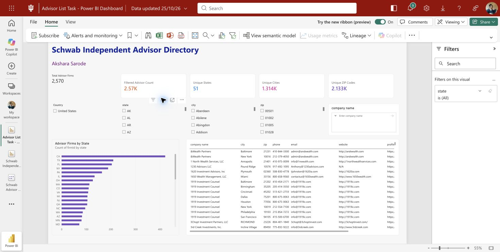

# Schwab Independent Advisor Directory

An interactive Power BI dashboard for exploring Registered Investment Advisory (RIA) firms by location. Built by **Akshara Sarode** using the submitted Part 1 advisor workbook.

**[Open the live Power BI report](https://app.powerbi.com/groups/c9955dea-8185-4c1e-acd7-ca412083b92d/reports/ec62f1e0-5f92-4276-ab23-c66fadfac5e3/1b44de2a555fc95ac2c3?experience=power-bi)** · [Download the PBIX](./Advisor%20List%20Task%20-%20Power%20BI%20Dashboard.pbix) · [View the PDF](./Advisor%20List%20Task%20-%20Power%20BI%20Dashboard.pdf)

> The live report may require Power BI access. The PDF is a static export; use the live report or PBIX for interactive filtering.

## Dashboard features

- **Five summary metrics:** Total Advisor Firms, Filtered Advisor Count, Unique States, Unique Cities, and Unique ZIP Codes.
- **Linked geographic filters:** Country, State, City, and ZIP Code dropdowns progressively narrow the advisor list.
- **Company selector:** The **Search Advisor / Firm** dropdown lists company names from the dataset. Selecting a firm updates the details and dynamic metrics.
- **Advisor details:** A sortable table with firm name, CRD, address, city, state, ZIP code, phone, email, website, and SEC profile. Scroll horizontally to see the right-hand columns.
- **Geographic charts:** Advisor Firms by State and Top 10 Cities by Advisor Firms.
- **Two report pages:** `Advisor Directory` and `Geographic Analysis`.

## Data source and metrics

The source is [`Submission File (Akshara).xlsx`](./Submission%20File%20%28Akshara%29.xlsx), using its populated `Schwab database` sheet. Power BI prepares an `Advisor Locations` table with **4,397 location rows**. Country is set to `United States`, and ZIP codes are stored as text to preserve leading zeros.

| Metric | Unfiltered value |
| --- | ---: |
| Total Advisor Firms | 2,570 |
| Filtered Advisor Count | 2,570 |
| Unique States, including DC | 51 |
| Unique Cities shown in the report | 1,314 |
| Unique ZIP Codes | 2,133 |

A firm can have multiple office locations. Firm metrics use **distinct firm IDs** so multiple offices do not inflate the advisor count. `Total Advisor Firms` is a fixed baseline label for this imported dataset; the other four KPI cards update when filters change.

## How to use the dashboard

1. Open the [live report](https://app.powerbi.com/groups/c9955dea-8185-4c1e-acd7-ca412083b92d/reports/ec62f1e0-5f92-4276-ab23-c66fadfac5e3/1b44de2a555fc95ac2c3?experience=power-bi) or open the PBIX file in Power BI Desktop.
2. Select a company name or choose Country, State, City, and ZIP Code values. The advisor list, charts, and dynamic counts update with your selections.
3. Click a column heading to sort the advisor table. To download filtered rows, use the table visual’s **More options (...) > Export data** command, if your Power BI account permits exports.
4. Select **Reset to default** to return to the full directory.

## Repository files

| File | Purpose |
| --- | --- |
| [`Advisor List Task - Power BI Dashboard.pbix`](./Advisor%20List%20Task%20-%20Power%20BI%20Dashboard.pbix) | Editable Power BI report with imported data |
| [`Advisor List Task - Power BI Dashboard.pdf`](./Advisor%20List%20Task%20-%20Power%20BI%20Dashboard.pdf) | Static two-page report export |
| [`Submission File (Akshara).xlsx`](./Submission%20File%20%28Akshara%29.xlsx) | Supplied Part 1 workbook |
| [`advisor_locations.csv`](advisor_locations.csv) | Portable location-row data export |
| [`Advisor_List_Task_Process_Documentation_Akshara.docx`](Advisor_List_Task_Process_Documentation_Akshara.docx) | Five-page process documentation |
| `powerbi_*.png` | Dashboard and filter-interaction screenshots |

## Filter evidence

The screenshots show the [unfiltered dashboard](powerbi_unfiltered.png), [populated company dropdown](powerbi_company_dropdown.png), [Alabama selection](powerbi_state_AL.png), and [Geographic Analysis page](powerbi_geographic_analysis.png).

Selecting Alabama showed **25 firms, 10 cities, and 23 ZIP codes**. Narrowing further to Birmingham showed **12 firms and 8 ZIP codes**.

## Process documentation

The [five-page process document](Advisor_List_Task_Process_Documentation_Akshara.docx) explains the source workbook, data preparation, dashboard structure, count logic, filter testing, export steps, and final deliverables. It distinguishes the supplied Part 1 collection process from the Power BI work completed for Part 2.
